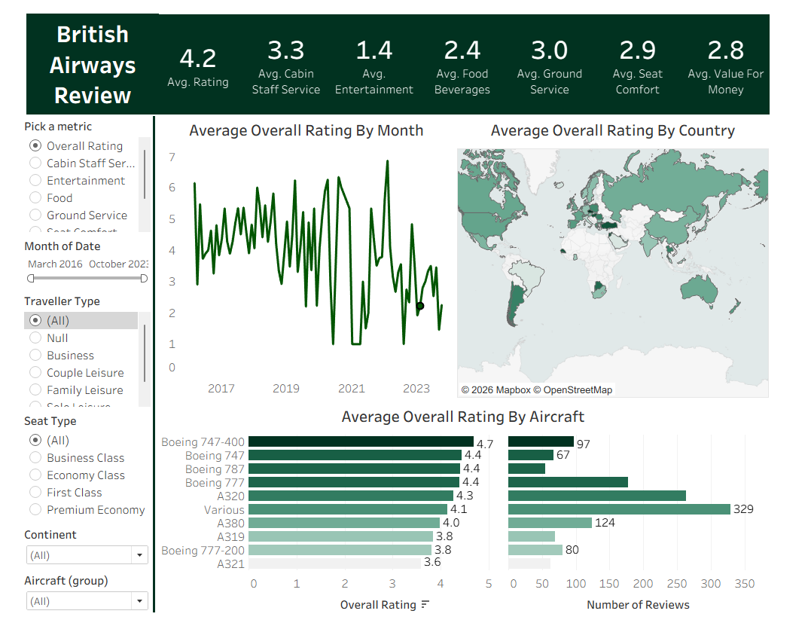

# ✈️ British Airways Review Analysis (Tableau Learning Project)

## 📌 Project Overview
This project is an interactive Tableau dashboard analyzing customer reviews for British Airways. 

**Note on Origin:** This dashboard was built as a guided learning project to master advanced Tableau features (such as KPI cards, parameter actions, and spatial mapping). I followed a public tutorial to replicate the analysis, which allowed me to practice building complex dashboards. I then applied my own design choices to present the insights clearly.

## 🛠️ Tech Stack & Skills Applied
*   **Tool:** Tableau Public
*   **Skills Practiced:** 
    *   Creating dynamic KPI cards using `SUM` and `AVG` aggregations.
    *   Building interactive parameter actions (e.g., switching between Overall Rating, Cabin Staff Service, etc.).
    *   Designing a clean, cohesive color palette for a professional look.
    *   Utilizing spatial data (Map visualizations by Country).

## 📊 Dashboard Preview

## 💡 Key Insights (What the Data Shows)
*   **Overall Rating:** British Airways holds a solid average rating of **4.2**.
*   **Aircraft Performance:** The Boeing 747-400 has the highest number of reviews (329) with a good average rating of 4.1, while the A321 has the lowest rating (3.6).
*   **Time Trend:** Ratings show high volatility over the years, with notable dips around 2020-2021 before recovering.

## 📂 Repository Structure
*   `airline_dashboard.png`: High-resolution image of the final dashboard.
*   `airline_analysis.twbx`: The packaged Tableau workbook file containing the full interactive dashboard and data. You can download and open this file in Tableau Desktop/Public.
